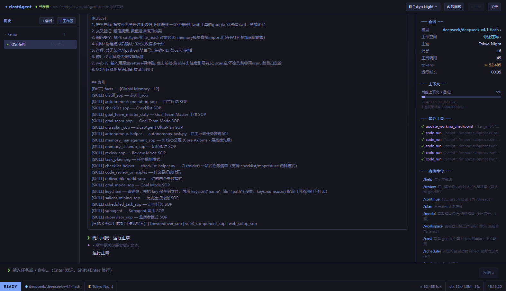
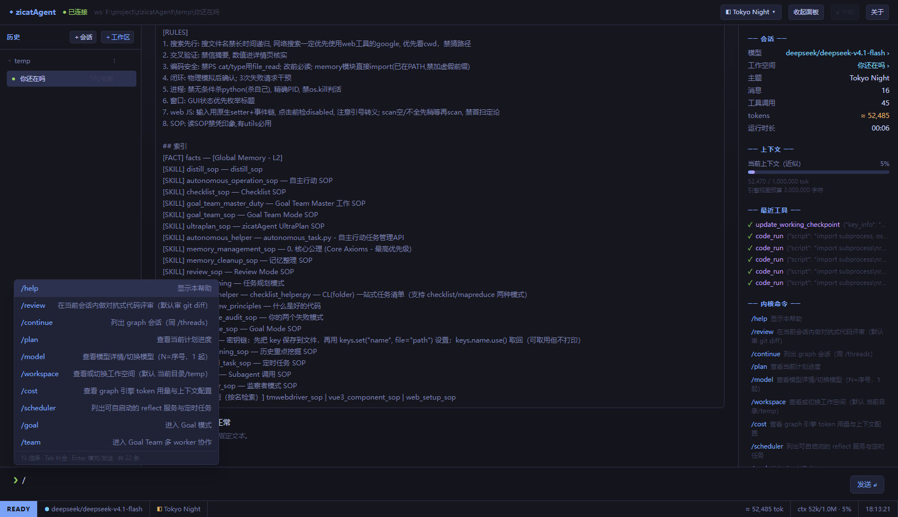
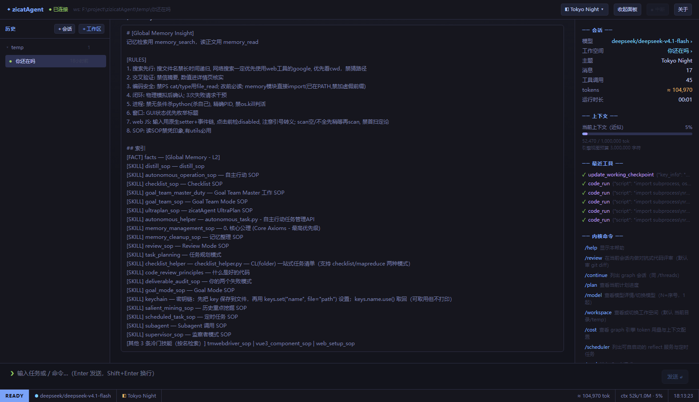
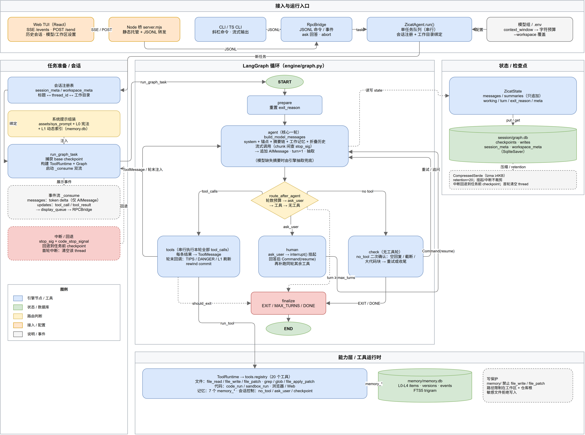
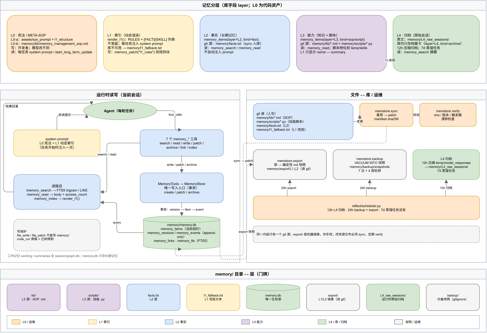

# zicatAgent

**zicatAgent** 是一个本地优先、可自演进的个人 Agent 执行内核：一个 LangGraph 循环 + 一套工具 + 一套 SQLite 长期记忆。它把任务经验沉淀成 SOP / 脚本，靠极简索引在后续任务里召回，让能力随使用生长，而不是每次重新教。

- **内核**：LangGraph 单引擎，会话状态持久化到 SQLite；消息只追加，不破坏前缀
- **工具**：20 个（13 个原子工具 + 7 个 `memory_*`），浏览器/终端/文件/搜索/记忆全覆盖
- **记忆**：SQLite 单库（L1–L4），版本与事件 append-only，FTS5 检索
- **前端**：Web UI（React + Vite + Tailwind，经 Node 桥走 JSONL RPC）
- **无** GUI 桌面壳 / IM bot；单机、单用户

---

## 界面预览



输入 `/` 打开内核命令补全；命令按钮只填入输入框，补全参数后再发送：



`/memory` 直接查看当前 L1 记忆索引：



---

## 快速开始

```bash
# 1. 依赖（推荐 venv）
python -m pip install -e .

# 2. 配置模型：复制 .env.example 为 .env，填 APIBASE / APIKEY / MODEL
copy .env.example .env
# （兼容：也可沿用旧 mykey.py；.env 的模型组存在时优先生效）

# 3. 构建并启动 Web UI
cd ui; npm install; npm run build
node ui/server.mjs           # → http://127.0.0.1:8765
```

Web UI 支持 `/model` 查看和修改模型配置（Base URL、API Key、模型名、上下文、最大输出、接口类型），以及 `/workspace <路径>` 切换工作空间。默认工作空间 `./temp`（不存在会创建），也可用 `--workspace` 覆盖。`/effort` 打开思考强度选择页（← → 选择，Enter 确认）。

### 可选依赖：ripgrep

`grep` / `glob` 会优先调用 [ripgrep](https://github.com/BurntSushi/ripgrep)；**不安装也能用**，会自动退回纯 Python 扫描（功能一致，大仓库会慢一些）。

```bash
winget install BurntSushi.ripgrep.MSVC   # Windows
brew install ripgrep                     # macOS
apt install ripgrep                      # Debian/Ubuntu
```

特殊场景可用 `ZICAT_RG_PATH` 指定 rg 路径，或 `ZICAT_NO_RG=1` 强制走兜底。

Web UI 通过 `ui/server.mjs` 桥接 `--rpc` 内核（SSE 下行 + POST 上行，仅 Node 内置模块）：
终端风格主题、消息块（回复/工具/系统）、`ask_user` 问答、Esc/按钮中断、用量与上下文统计，
slash 命令与内核 `core/commands.py` 完全一致（透传内核，补全表由后端下发）。

> 📖 **使用说明（必读）**：[docx/guide/USER_GUIDE.md](docx/guide/USER_GUIDE.md) —— 对话方式、
> 全部 19 个 slash 命令详解、会话管理（/new /resume /rewind）、记忆系统、常见问题，一份读完即可上手。

## 运行模式

| 模式 | 命令 | 说明 |
|---|---|---|
| Web UI | `node ui/server.mjs` | 浏览器打开 `http://127.0.0.1:8765`；唯一用户前端 |
| 持续协作 | `python agentmain.py --task 名字 --input "..."` | 常驻子 agent，靠 `temp/<名字>/` 下的 `output.txt` / `reply.txt` / `_stop` / `_keyinfo` / `_intervene` 通信 |
| 纯函数 | `python agentmain.py --func prompt.txt` | 读 prompt → 结果写 `*.out.txt` → 退出，适合并行 map |
| 无人值守 | `python agentmain.py --reflect reflect/scheduler.py` | 脚本用 `check()` 轮询决定何时触发任务 |
| RPC | `python agentmain.py --rpc` | stdin/stdout JSONL；Web UI 与自动化脚本的内部协议 |

`--nobg` 前台运行、`--nolog` 不写模型日志、`--no-user-tools` 禁用 `ask_user` 与 `start_long_term_update`。

## Slash 命令

`/help`、`/cost`、`/threads`、`/resume`、`/continue`、`/rewind`、`/memory`、`/plan`、
`/review`、`/scheduler`、`/goal`、`/team`、`/autorun`、`/distill`、`/update`、`/exit`、
`/effort`，以及会话管理 `/new` `/del`、模型切换 `/model`。
普通文本直接作为任务发给 agent。

**完整用法（含每个命令的详细说明、会话管理、记忆系统速览、常见问题）见
[用户使用手册](docx/guide/USER_GUIDE.md)**。

## 架构

```
Web UI (ui/) ──SSE/POST──▶ ui/server.mjs ──JSONL──▶ agentmain.py --rpc
--task / --func / --reflect（自动化入口）
        │
        ▼
engine/  LangGraph: prepare → agent ⇄ tools → human(check) → finalize
        │                         │
        ├── SQLite checkpointer ──┤  session/graph.db
        └── SQLite memory ────────┘  memory/memory.db
```

- **engine/**：状态图、模型视图（重锚/折叠/摘要）、检查点、跨进程 resume、rewind
- **core/**：内核命令、RPC、模式提示词、回退存储、评审
- **memstore/**：SQLite 记忆库、7 个记忆工具、L1 渲染、迁移/同步/导出/备份
- **zicat.py**：兼容壳/公共 API；工具实现见 tools/
- **ui/**：唯一用户前端（React/Vite/Tailwind + Node 桥 `server.mjs`）
- **reflect/**：scheduler / goal / autonomous / team worker

### Agent Loop



### Memory



## 目录

```
agentmain.py     入口：任务队列、system prompt 组装、运行模式、--rpc
agent_types.py   公共类型 StepOutcome / BaseHandler / exhaust
mykey_loader.py  mykey.py 配置加载
zicat.py         兼容壳（handler 状态/公共 API）；工具实现见 tools/（17 个，registry 装配）
tools/           工具域包：code/files/browser/memory/session_ctl + registry
core/            内核逻辑（命令/模式提示词/计划/回退/评审/JSONL 协议）
engine/          LangGraph 引擎（图/状态/工具适配/检查点/runner/回退/回调）
memstore/        SQLite 记忆库（schema/仓库/工具/迁移/校验/同步/导出/备份）
ui/              唯一用户前端（React 19 + Vite + Tailwind；Node 桥 server.mjs 走 --rpc，SSE+POST）
tests/           单测 + 进程集成（python -m unittest tests.test_engine tests.test_integration）
simphtml.py      网页 HTML 整理（web_scan 依赖）
TMWebDriver.py   本地 WS + Chromium 系扩展（Chrome/Edge），操作真实浏览器；可常驻复用
reflect/         无人值守：scheduler / goal_mode / checklist_master / agent_team_worker / autonomous
memory/          运行时：SQLite 记忆库 + kb/（SOP 文档）+ L4 归档/备份/导出
assets/          提示词、工具 schema、浏览器扩展
docx/            开发文档四层：guide（导读/讲解）/ arch（架构事实）/ dev（版本目标）/ explain（版本差异）
temp/            运行时工作区（gitignore）
```

## 文档

- 开发文档（事实源）：[docx/index.md](docx/index.md)
- 当前架构：[docx/arch/v1/index.md](docx/arch/v1/index.md) · [架构可视化](docx/arch/v1/architecture.html)
- 版本进度：[docx/dev/v0.1.0/todolist.md](docx/dev/v0.1.0/todolist.md)（内核基线）· [docx/dev/v0.1.1/todolist.md](docx/dev/v0.1.1/todolist.md)（Web TUI）
- **用户使用手册**（slash 命令详解）：[docx/guide/USER_GUIDE.md](docx/guide/USER_GUIDE.md)
- 项目导读与原理讲解：[docx/guide/README.md](docx/guide/README.md)

## 注意

1. `code_run` 用当前用户权限执行任意代码，**无沙箱**；二次开发请自行加限制。
2. 浏览器工具需先装 `assets/tmwd_cdp_bridge/` 扩展（见 `memory/kb/web_setup_sop.md`）。
3. `memory/` 纳入版本控制（`memory.db` 除外），进化出的技能可回滚。
4. 会话消息只追加、记忆版本只追加；需要压缩上下文时追加摘要，不删旧消息。
