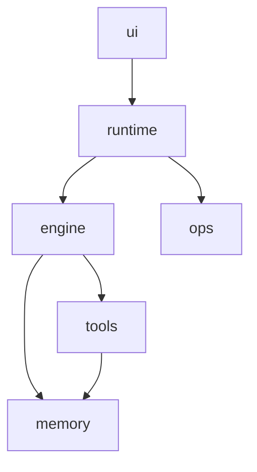

# v1 架构说明

> 状态: 生效
> 前代: 无
> 生效范围: dev v0.1.0 ~ 至今
> 建立日期: 2026-10-23
> 最后更新: 2026-10-23
> 对应决策: ADR-0001、ADR-0002、ADR-0003
> 相对前代的变更: 初版架构（LangGraph 单引擎 + SQLite 检查点/记忆 + JSONL RPC 前端）

## 系统定位

zicatAgent 是一个本地单用户、可自演进的 Agent 执行内核：接收任务，循环调用模型与工具，把会话状态持久化到 SQLite，把长期经验沉淀到 SQLite 记忆库，最终通过 CLI/RPC 返回结果。边界是"单机、单任务、无多租户、无沙箱"。

## 技术栈

| 类别 | 选型 | 版本 | 说明 |
|------|------|------|------|
| 语言 | Python | 3.10–3.13 | 内核 |
| 引擎 | LangGraph / LangChain Core | `>=0.6` / `>=0.3` | 状态图、检查点、interrupt |
| 模型 | `langchain-openai` | `>=0.3` | 仅 OpenAI 兼容接口 |
| 状态存储 | SQLite + `langgraph-checkpoint-sqlite` | `>=2.0` | `session/graph.db`，WAL |
| 记忆存储 | SQLite（自研 `memstore`） | 标准库 | `memory/memory.db`，WAL，FTS5 |
| 通信 | JSONL over stdio | — | `--rpc`，Web UI/脚本消费 |
| 测试 | `unittest` | 标准库 | 单测 + 进程级集成 |

## 分层结构

| 层 | 职责 | 包含模块 |
|----|------|----------|
| 接入层 | 用户输入、命令分发、展示、RPC 协议 | `ui` |
| 应用层 | 进程生命周期、任务投递、运行模式、无人值守调度 | `runtime`、`ops` |
| 控制层 | 图编排、模型视图、检查点、回退、中断恢复 | `engine` |
| 能力层 | 工具执行、长期记忆、SOP 检索 | `tools`、`memory` |
| 基础设施 | SQLite、OpenAI API、文件系统、本地 Chrome | 非模块（外部依赖） |

## 模块清单

| 模块 id | 模块名 | 所属层 | 一句话职责 | 对外契约 | 依赖 |
|---------|--------|--------|------------|----------|------|
| ui | Web 前端 | 接入层 | React Web UI、内核命令分发、JSONL RPC | `handle()`、RPC 事件、`ui/server.mjs` | runtime |
| runtime | 运行入口 | 应用层 | 进程生命周期、模式路由、任务投递 | `put_task()`、`run()`、`--task/--func/--reflect/--rpc` | engine、ops |
| ops | 自动化与工程 | 应用层 | reflect 脚本、定时任务、测试与文档 | `check()` 契约、测试命令 | 无 |
| engine | 图引擎 | 控制层 | LangGraph 状态图、模型视图、检查点、中断、回退 | `ZicatState`、`run_graph_task()`、`resume_pending()` | tools、memory |
| tools | 工具系统 | 能力层 | 16 个工具、dispatch、schema、浏览器/文件/代码能力 | `dispatch()`、`ToolRuntime.run_tool()`、`tools_schema.json` | memory |
| memory | 记忆系统 | 能力层 | SQLite 记忆库、7 个记忆工具、L1 渲染、同步/导出/备份 | `MemoryStore`、`memory_*`、`load_L1()` | 无 |

> 模块 id 必须与 `modules.md` 的小节标题和 `architecture.html` 的 `ARCH.modules[].id` 一致。

## 模块依赖图

```text
ui ──→ runtime ──→ engine ──→ tools ──→ memory
             │
             └──→ ops
```



## 全局约束

- **单用户/单任务**: 一个进程同一时间只跑一个任务；RPC 与 CLI 串行。
- **只追加**: 会话 `messages` 与 `summaries` 用 `operator.add`；记忆版本/事件只 insert。
- **状态与记忆分库**: `temp/graph.db` 高频写，`memory/memory.db` 低频写，物理隔离。
- **模型不直接写记忆**: 只能经 7 个 `memory_*` 工具；文件写入 `memory/` 被拦截。
- **模型接口**: 仅 OpenAI 兼容；`base_url`/`key`/`model` 由 `mykey.py` 提供。
- **无沙箱**: `code_run` 以当前用户权限执行；高风险动作依赖 `ask_user` 与模型自觉。
- **前端可替换**: CLI 与内核只通过 `put_task`/RPC 交互，不共享内存状态。

## 相对前代的变更

初版架构，无前代。
